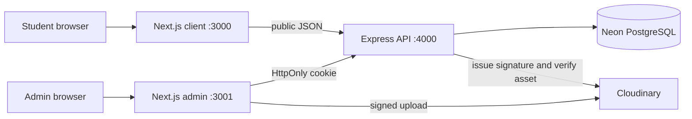

# Red Bull TUT

A public campus events and announcements website, a separate administrator application, and an Express API backed by PostgreSQL. Public pages show only database records published by authorized administrators; no event records or default admin accounts are seeded.

## Applications

- `client/` — public Next.js student website on port 3000.
- `admin/` — separate Next.js administrator application on port 3001.
- `backend/` — Express 5 API on port 4000, PostgreSQL migrations and bootstrap scripts.
- `docs/` — architecture, API, data, security, testing, deployment and development guidance.

The two web apps use Next.js App Router, React, TypeScript, Tailwind CSS 4, Lucide React, and local shadcn-style components. The admin adds React Hook Form and Zod. The backend uses Express 5, `pg`, Zod, bcrypt, JWT cookies, Helmet, rate limiting, Pino and Cloudinary.



## Requirements

- Node.js 20.9 or newer (verified here with Node 26.5.0) and npm.
- A Neon PostgreSQL connection string for persistent API data.
- Cloudinary credentials for poster uploads.
- An authorized administrator credential supplied only during secure bootstrap.

## Install

Each app has its own dependency tree and lockfile so it can be deployed independently. This machine's npm policy blocks package lifecycle scripts; the installs below preserve that policy.

```powershell
Push-Location client; npm ci --ignore-scripts; Pop-Location
Push-Location admin; npm ci --ignore-scripts; Pop-Location
Push-Location backend; npm ci --ignore-scripts; Pop-Location
```

Copy each `.env.example` to `.env` and set values locally. Never commit `.env` files.

- `client/.env`: public API URL and public site URL.
- `admin/.env`: public API URL, admin site URL and student-site URL.
- `backend/.env`: database URL, JWT settings, exact frontend origins, cookie settings, and Cloudinary credentials.

## Database and administrator

Create a Neon database, set `backend/.env`, then run:

```powershell
npm run migrate --prefix backend
npm run seed --prefix backend
```

Migration `001_initial.sql` creates schema and canonical campuses; the seed command is idempotent and inserts no events. To create the first admin, set `INITIAL_ADMIN_EMAIL`, `INITIAL_ADMIN_NAME`, and `INITIAL_ADMIN_PASSWORD` in the local environment for that one command. Use a unique password of at least 16 characters. Do not place credentials in source control or paste them into chat.

```powershell
npm run create-admin --prefix backend
```

The script hashes the password with bcrypt and does not print it. There is no public admin registration endpoint.

## Run locally

Use separate terminals:

```powershell
npm run dev:backend
npm run dev:client
npm run dev:admin
```

Open `http://localhost:3000` for students and `http://localhost:3001/login` for administrators. The public website works without login. Admin login and protected operations require a configured database and a bootstrapped admin.

## Verify

```powershell
npm run test:backend
npm run build:backend
npm run build:client
npm run build:admin
npm run lint --prefix client
npm run lint --prefix admin
```

Backend unit/schema tests do not require Neon. Database migration, protected API integration, end-to-end login, and Cloudinary upload verification require service credentials and have not been run in this workspace.

## Brand asset

The user-supplied Red Bull Energy Drink mark is stored at `client/public/images/red-bull-tut-logo.png` and displayed proportionally beside the Red Bull TUT text wordmark. The Campus in Motion feature requests the supplied Red Bull Energy Drink can URL and falls back to `client/public/images/red-bull-xero.png` when the remote host is unavailable. The supplied campus sampling photo is used as the responsive homepage hero background.

Red Bull TUT is treated as an independent product identity; no TUT or Red Bull partnership or endorsement is claimed.

## Deployment

Deploy `client/` and `admin/` as separate Vercel projects with their respective environment variables. Deploy `backend/` to a persistent Node host; `render.yaml` provides a Render service blueprint and runs migrations as a pre-deploy step. Set exact production origins in backend CORS. For cross-site Vercel/API domains, the example Render settings use `SameSite=None; Secure`; verify cookie behavior in the actual production domains. Prefer related custom domains where possible.

See [docs/DEPLOYMENT.md](docs/DEPLOYMENT.md) for the production checklist and [docs/SECURITY.md](docs/SECURITY.md) for session/upload details.
