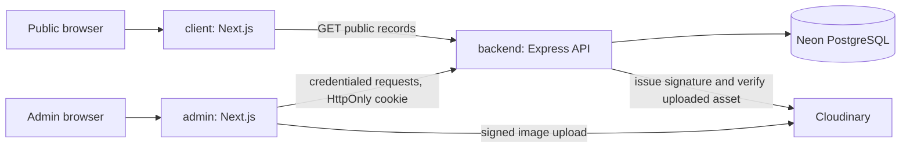

# Architecture

## Boundaries

`client/` is public and does not authenticate. `admin/` is independently deployable and uses API-set HttpOnly cookies. `backend/` owns validation, persistence, authorization, publication rules and signed-upload verification. There is no shared database access from either Next app.

## Data rules

- Public event feeds return published, non-deleted, future events only. A slug detail request may return a cancelled event so its cancellation state remains visible; drafts and archived items stay private.
- Public announcement responses include only published, non-deleted records inside their start/expiry window.
- Event and announcement writes are authenticated and schema-validated on the API.
- Canonical campus names and slugs are seeded by the initial SQL migration and the idempotent seed command.
- No event fixture data or default admin is created.

## Session flow

1. Admin submits email/password to `POST /api/v1/auth/login`.
2. API checks bcrypt hash and active-admin status, creates a database session UUID and short-lived HS256 JWT.
3. JWT is set in an HttpOnly cookie. The browser stores no bearer token.
4. Protected middleware validates issuer, audience, signature, expiry, and active DB session on each request.
5. Logout revokes the DB session and clears the cookie.

## Upload flow

1. Authenticated admin requests a signature.
2. API creates a 15-minute upload intent bound to the administrator and session, signs the configured Cloudinary asset folder and a generated public ID.
3. Browser uploads directly to Cloudinary using the signature.
4. Event create/update sends the URL and public ID.
5. API checks the one-use upload intent and retrieves the Cloudinary asset server-side before saving its URL.

## Runtime and deployment

The Express API is a persistent Node service, not a Vercel function. Frontends can deploy independently to Vercel. API origin allowlisting is exact. Production cookie settings depend on the selected public/admin/API domains; see [DEPLOYMENT.md](DEPLOYMENT.md).
